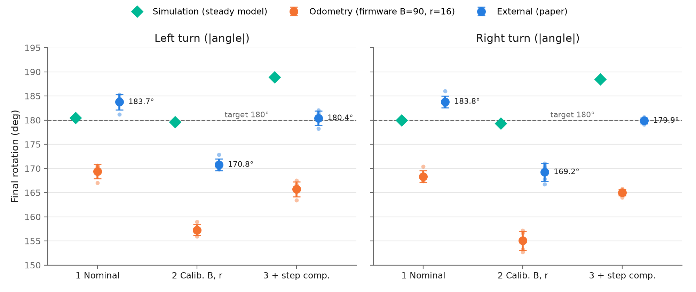
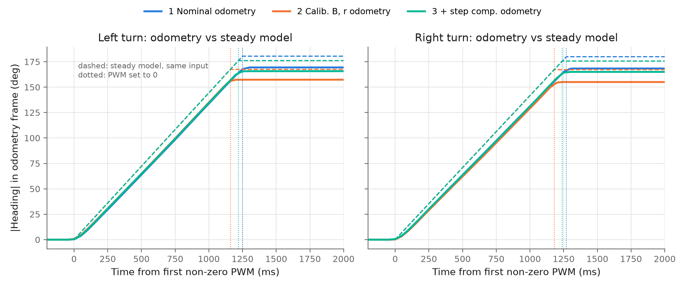

# E2 原地转 180° 三组对比（simulation / real_odometry / external_pose）

PWM 固定（左转 −41/40，右转 40/−39），只改时长。每组每方向 5 次，先左 1–5 再右 1–5。原始数据见 `logs/E2_turn_*_180*_run*.csv` 与 `logs/E2_turn_180*_external.csv`，分析脚本 [analyse.py](analyse.py)，逐次数值 [results.json](results.json)。

| 组 | 参数 | 左转时长 | 右转时长 |
|---|---|---:|---:|
| 1 | B=90, r=16（名义） | 1250 ms | 1270 ms |
| 2 | B=85.8, r=16.36（只改 B、r） | 1160 ms | 1180 ms |
| 3 | 2 + 阶跃补偿 +63 ms（`calc_motion_params.py --step-comp`） | 1220 ms | 1240 ms |

## 1. 终点转角（绝对值，均值 ± 样本标准差，n = 5）

| 组 | 方向 | 仿真 (°) | 里程计 (°) | 坐标纸 (°) | 坐标纸 − 180 (°) | 坐标纸 / 里程计 | 里程计 / 稳态模型 | 中心偏移 (mm) |
|---|---|---:|---:|---:|---:|---:|---:|---:|
| 1 | 左 | 180.5 | 169.4 ± 1.5 | 183.7 ± 1.6 | +3.7 | 1.085 | 0.939 | 0.5 |
| 1 | 右 | 179.9 | 168.3 ± 1.2 | 183.8 ± 1.2 | +3.8 | 1.092 | 0.936 | 2.2 |
| 2 | 左 | 179.6 | 157.3 ± 1.1 | 170.8 ± 1.2 | -9.2 | 1.086 | 0.939 | 0.8 |
| 2 | 右 | 179.3 | 155.0 ± 2.0 | 169.2 ± 1.9 | -10.8 | 1.092 | 0.927 | 2.2 |
| 3 | 左 | 188.9 | 165.7 ± 1.6 | 180.4 ± 1.5 | +0.4 | 1.089 | 0.941 | 1.8 |
| 3 | 右 | 188.4 | 165.0 ± 0.7 | 179.9 ± 0.6 | -0.1 | 1.090 | 0.939 | 2.9 |

- 仿真：fit.json 稳态模型，10 ms 欧拉积分，用本组的 B、r；没有起步和停车过程。
- 里程计：固件输出（r=16、B=90，三组相同）。
- 里程计 / 稳态模型：同一输入在里程计坐标（r=16、B=90）下，实测与稳态模型之比，反映起停过程少转的比例。
- 第 3 组仿真约 189°：时长补了 63 ms，而仿真没有起停过程，稳态模型按全速多算了这 63 ms，这部分正是实车起停时少转的量。

## 2. 组间差异（坐标纸）

| 方向 | 比较 | 差 (°) | Welch t |
|---|---|---:|---:|
| 左 | 1 vs 2 | +13.0 | +14.2 |
| 左 | 2 vs 3 | -9.7 | -11.1 |
| 左 | 1 vs 3 | +3.3 | +3.4 |
| 右 | 1 vs 2 | +14.6 | +14.6 |
| 右 | 2 vs 3 | -10.6 | -12.1 |
| 右 | 1 vs 3 | +3.9 | +6.4 |

## 3. 图

## 4. 跑前预测与结果

| 组 | 跑前预测（坐标纸） | 实测 左 / 右 |
|---|---|---|
| 2 | 约 170° | 170.8° / 169.2° |
| 3 | 178–180° | 180.4° / 179.9° |

## 5. 局限

- 阶跃响应在 PWM 51–58 直线上测得，原地转 PWM 39–41 属外推。
- 试验顺序为每组先左后右，没有左右交替；每次实验前电量 90%–100%。
- 坐标纸读数为车头、车尾轴线投影，起点间距 97 mm；终点间距见 results.json。
