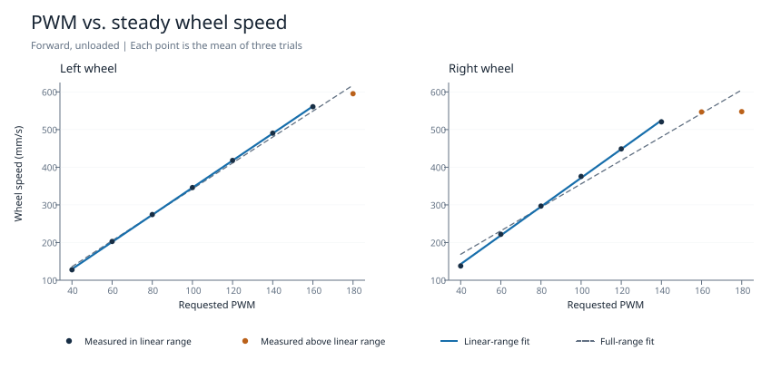

# 左右轮 PWM—稳态轮速线性拟合

2026-11-24 架空分轮前进测试。两轮各测 PWM 40–180，每隔 20 一个档位，每档重复 3 次。只取 `MEASURE`，先按试次求稳态均速，再按 PWM 档求均值，最后对各档均值做等权最小二乘拟合。

| 轮子 | 拟合区间 | 公式（mm/s） | R² | RMSE（mm/s） |
| --- | --- | --- | ---: | ---: |
| 左轮 | 全范围 40–180 | $v_L=3.441910\,PWM_L-1.635252$ | 0.995600 | 10.49 |
| 左轮 | 线性段 40–160 | $v_L=3.603033\,PWM_L-14.525098$ | 0.999950 | 1.02 |
| 右轮 | 全范围 40–180 | $v_R=3.116976\,PWM_R+44.186857$ | 0.957137 | 30.23 |
| 右轮 | 线性段 40–140 | $v_R=3.817527\,PWM_R-9.928359$ | 0.999366 | 3.29 |

蓝线为线性段拟合，灰色虚线为全范围拟合，橙色点是线性段以外的实测均值。

左轮从 PWM 160 升到 180 时，轮速增加 34.60 mm/s。右轮在同一区间只增加 0.80 mm/s。本批数据采用左轮 40–160、右轮 40–140 的直线描述稳态关系。

[分析脚本](analyse.py) · [各档均速与残差](pwm_means.csv) · [拟合参数](linear_fits.csv)
